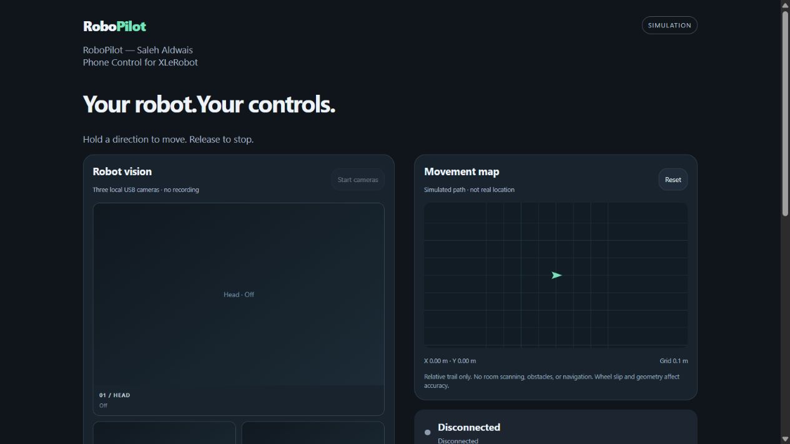

# RoboPilot — Saleh Aldwais

**Phone Control for XLeRobot** · Prototype v0.1.0 · Author: Saleh Aldwais

A local phone-friendly driving panel with three opt-in USB camera views and a relative movement map. The laptop rides on the robot and stays connected to its motor boards; the phone connects over trusted Wi-Fi. No cloud service or AI training is required.

## Current support and what's next

**Available now:** wheel-direction controls for forward, backward, left/right turns and curves, plus viewing all three configured robot cameras together (Head, Left Wrist, Right Wrist).

**Coming next:** arm and gripper control. These controls will be added after calibration and testing; they are not part of the current release.

Live camera viewing requires the three cameras connected to the laptop, the optional camera dependency, and the correct device indices. The implementation is ready for robot-side testing; physical three-camera operation has not yet been validated on this build.

> Prototype: simulation and automated tests pass. This new panel's live cameras, real encoder path tracking, and hardware driving still need robot-side validation. SO-101 arm/gripper, Xbox, and Quest controls are not implemented. This is an independent project, not an official XLeRobot/LeRobot release.

## Features

- Forward, backward, turn-in-place, and curved driving buttons.
- Hold to drive; release disarms. Large STOP button, focus-loss stop, command-expiry timeout.
- Bounded raw speed commands (5–50), default 10; no torque-limit increase.
- Three independent local camera views: Head, Left Wrist, Right Wrist. Device assignments are configurable. Start/Stop cameras explicitly; no recording or cloud uploading.
- Relative path map from wheel-position readings in hardware mode. Simulation displays a labeled simulated path. This is NOT room scanning, SLAM, obstacle detection, GPS, or autonomous navigation.
- Per-launch access key, authenticated image endpoints, and one armed client at a time.
- Keys: 8 forward, 2 backward, 6 left, 4 right, 5/Space stop (requested custom layout).



## Quick start — simulation, no robot needed

Install Python 3.12 or later. Download this repository, open a terminal in it, and run:

```powershell
python server.py
```

Open the full laptop URL printed in the terminal, including the `#` access key. No motor/camera libraries are needed for simulation. Click Connect wheels, Arm driving, then hold a direction. Press ARM again for each new hold after stopping.

For phone access on the same trusted Wi-Fi:

```powershell
python server.py --bind 0.0.0.0
```

Use the printed phone URL. Windows may prompt for private-network access. No automatic firewall rules or public hosting are configured. The Windows launcher `START_PHONE_PREVIEW.cmd` starts LAN simulation and prints the URLs; it tries a project virtual environment, then the Windows Python launcher.

## Three live cameras

Create an isolated environment and install the optional camera dependency:

```powershell
python -m venv .venv
.\.venv\Scripts\python.exe -m pip install -r requirements-camera.txt
.\.venv\Scripts\python.exe server.py --bind 0.0.0.0 --enable-cameras --camera-indices 0,1,2
```

This command keeps MOTOR control simulated but permits real camera capture after pressing Start cameras. Capture does not start automatically. Indices 0,1,2 are placeholders: verify which USB camera is Head, Left Wrist, and Right Wrist; the laptop webcam may occupy one index. Each view is 640×360 JPEG, refreshed approximately 4 times/second by the browser. Actual performance depends on USB bandwidth/Wi-Fi. Unavailable/stale frames are explicitly labeled; fake live video is never shown.

## Hardware setup — supervised only

The wheel-only adapter targets STS3215 model 777, protocol 0, 1,000,000 bps. Stock IDs: left wheel 9, right wheel 10, normally COM7 on the original build. Ports can change. Arms and head are not addressed.

Before hardware launch: secure the top frame, manage cables, verify physical mounting/front and direction signs on raised wheels, confirm wheel mode, and disconnect Bambot so serial is free. Both wheel IDs must already be in velocity mode; the panel does not reassign IDs or change operating modes.

```powershell
.\.venv\Scripts\python.exe -m pip install -r requirements-hardware.txt
.\.venv\Scripts\python.exe server.py --hardware --directions-verified --serial-port COM7 --bind 0.0.0.0 --enable-cameras --camera-indices 0,1,2 --wheel-radius 0.05 --wheelbase 0.25
```

Starting the server does not open serial or move motors. Connect wheels opens/verifies the bus and sends zero speed/torque off. ARM then hold a direction to drive. Speed cap 50 is a raw motor command, not metres/second. Physical velocity and stopping distance are not validated.

Wheel radius 0.05 m and wheelbase 0.25 m are **uncalibrated reference assumptions**; measure your own and pass the values in metres. Physical signs/dimensions must be verified, not inferred from a clockwise description viewed from opposite sides.

### Reference direction signs

Mirrored stock motor mounting requires ID9 inversion:

| Motion | ID9 left | ID10 right |
| --- | --- | --- |
| Forward | -s | +s |
| Backward | +s | -s |
| Left turn | +s | +s |
| Right turn | -s | -s |
| Forward-left curve | -s/2 | +s |
| Forward-right curve | -s | +s/2 |
| Stop | 0 | 0 |

A two-wheel differential robot cannot slide sideways. The map starts at (0,0), not a known room location. Encoder wrapping is handled modulo 4096; sampling assumes less than half a revolution between samples. Slip, missed reads, geometry errors and reversed mounting cause drift. Reset only while disarmed; stale telemetry is labeled. No room images, maps or path logs are saved to disk.

## Stop behavior and limits

Release the direction, press STOP, or press 5/Space. Focus loss/hidden pages request STOP. A server timeout of 350 ms without valid command heartbeats attempts zero speed and wheel torque disable. Actual latency includes OS/network/serial delays. Ctrl+C attempts cleanup.

**This is not a hardware emergency stop.** A frozen process, lost serial link, driver fault or OS failure can prevent software stopping. Keep a physical external motor-power cutoff accessible; cut 12V if software stop fails. Never operate unattended. [Security and privacy](SECURITY.md).

No physical calibration, collision avoidance, autonomous navigation, grabbing or load carrying is provided. Arms/grippers remain visibly locked until a separate calibration-aware driver is implemented and tested.

## Tests and validation

```powershell
python -m unittest discover -s . -p "test_*.py"
```

22 automated tests cover direction signs, timeouts, stale requests, ownership, speed cap, encoder wrapping, map resets, camera opt-in/staleness, authenticated status/images, and cross-origin command rejection. Browser preview checked separately. Physical three-camera streaming, phone Wi-Fi behavior and hardware odometry remain unverified.

## License and acknowledgments

RoboPilot source: [MIT License](LICENSE), copyright 2026 Saleh Aldwais. Dependencies keep their own licenses. See [NOTICE.md](NOTICE.md) for XLeRobot, LeRobot, OpenCV and development assistance credits.

References:
- [XLeRobot two-wheel implementation and mirrored-wheel convention](https://github.com/Vector-Wangel/XLeRobot/blob/main/software/src/robots/xlerobot_2wheels/xlerobot_2wheels.py)
- [LeRobot](https://github.com/huggingface/lerobot)

No claims of SO-101 arm support or hardware certification are made by this prototype.

